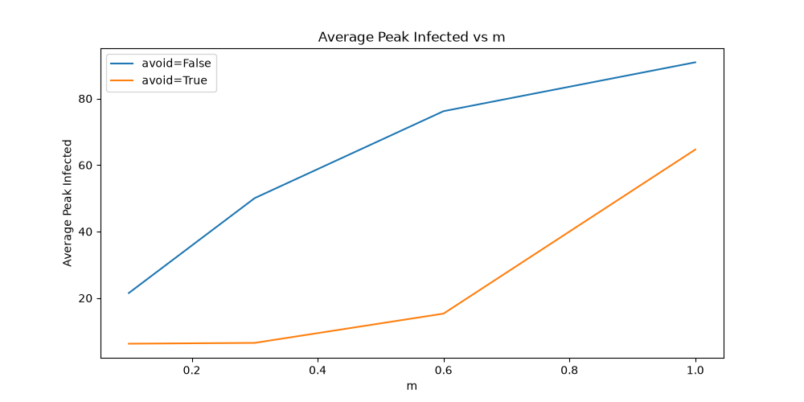
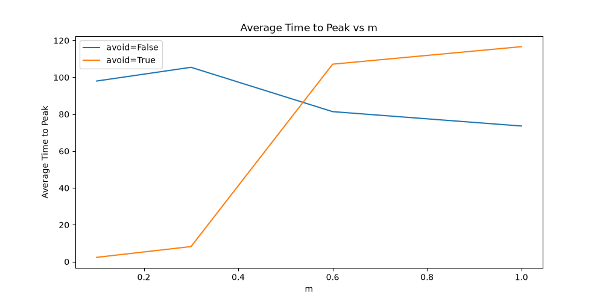
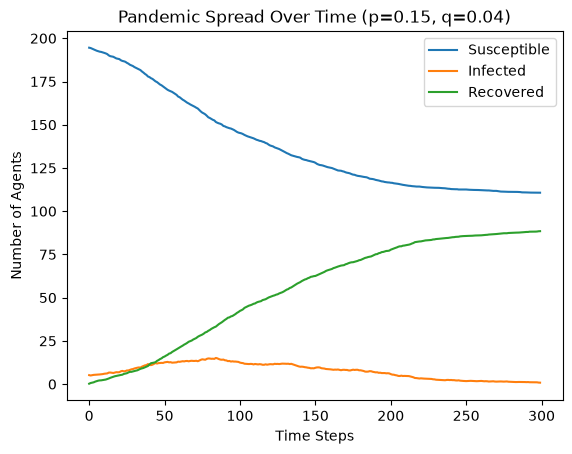
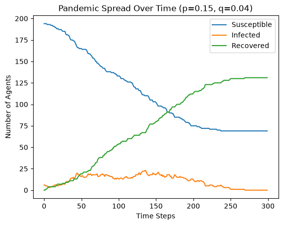
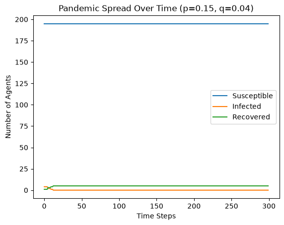
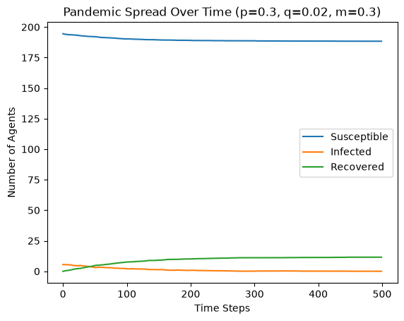
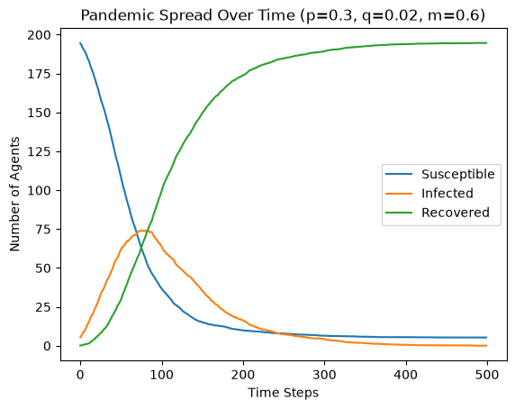

## Setup

The code requires only `numpy` and `matplotlib`. After cloning the repo, install them with:

```bash
pip install -r requirements.txt
```

## Discussion
 
### A.iv. Sensitivity Analysis
 
**How much do individual runs differ from the average?**
 
Overall, the individual runs are similar to the average across the 20 runs. With `p=0.15` and `q=0.04`, however, they differ visibly. Depending on the random initialization, some runs end with more recovered than susceptible agents, while others end with the reverse.
 
**In how many runs does the outbreak die out early?**
 
In 4 runs (runs 3, 6, 14, and 19), the number of recovered agents plateaued below 50, meaning the pandemic infected less than 25% of the population. In 2 of these 4 runs, there was no increase in recovered agents and no peak in infected agents, suggesting the outbreak never took off despite the presence of infected agents.
 
### B.i. Introducing Social Distancing Measures
 
**Which parameter controls the maximum number of simultaneously infected agents? Which determines whether the healthcare system is overwhelmed?**
 
Reduced movement (`m`) appears to be the more important factor: the difference between `m=1` and `m=0.01` is greater than the difference between avoidance on and off. The healthcare system is overwhelmed when the number of simultaneously infected agents is high, especially when that number rises quickly.
 
### B.ii. Comparing Results With and Without Social Distancing
 
**Peak number of infected agents**
 
With social distancing (avoidance), the peak number of infected agents is much lower in most settings. The gap narrows as movement increases, presumably because agents are surrounded by infected agents more often and can no longer distance themselves from them.
 
**Time to peak and time until no infected agents remain**
 
The time to peak without social distancing is not necessarily shorter. This may be because very effective social distancing prevents the pandemic altogether, so there is no major peak.
 
**Total number of agents ever infected**
 
The total number of agents ever infected is the sum of recovered and infected agents at the final time step. The difference between the two conditions is significant. However, as noted above, the gap narrows at higher movement rates, where avoiding infected agents becomes impossible.
 
**Implications for real-world public health interventions**
 
In real life, it is difficult to know exactly whom to avoid, so limiting movement is important. The results clearly suggest that combining social distancing with reduced movement leads to the best outcome: a lower and later peak, and fewer total infections.
 
### B.iii. Strength of Distancing
 
**How does stricter or more relaxed distancing affect the epidemic?**
 
Stricter distancing is always better. Although the average time to peak is earlier when agents both avoid infected agents and move less, the peak number of infected agents is significantly lower. The effect of distancing is therefore monotonic: the stricter, the better.

## Hypotheses Revisited

### 1. Movement reduction lowers and delays the infection peak

Reducing the movement rate `m` lowers the peak number of infected agents. With avoidance enabled (`avoid=True`) and a low movement rate, the time to peak is short, but the peak itself is very low, meaning the pandemic is effectively prevented.




### 2. Trajectories vary with random initialization but are consistent on average

With `p=0.15` and `q=0.04`, the average trajectory over all runs looks like this:



Individual runs with the same parameters can look very different depending on the random initial positions. In the first run below the pandemic spreads successfully; in the second it dies out early.




### 3. Resemblance to the SIR curve depends on the parameters

Depending on which parameters are included and their values, the simulated curves may or may not resemble the classic SIR curve.




## AI Use Statement

[Describe how AI tools were used, following your course's policy.]